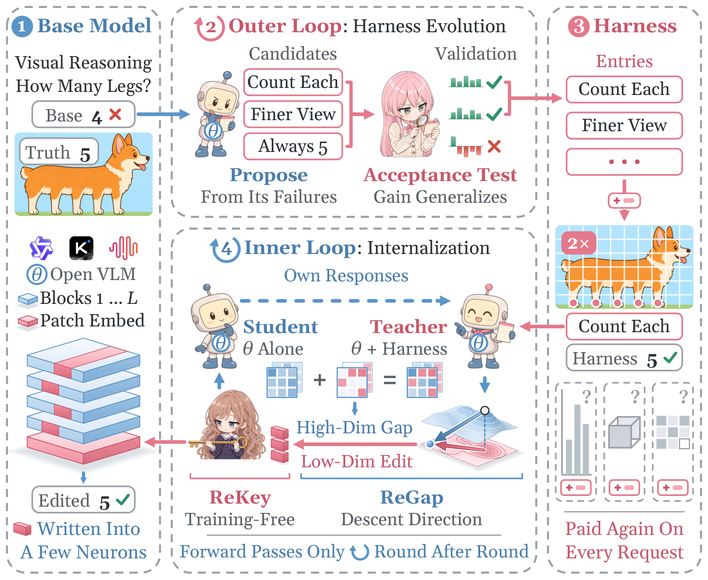
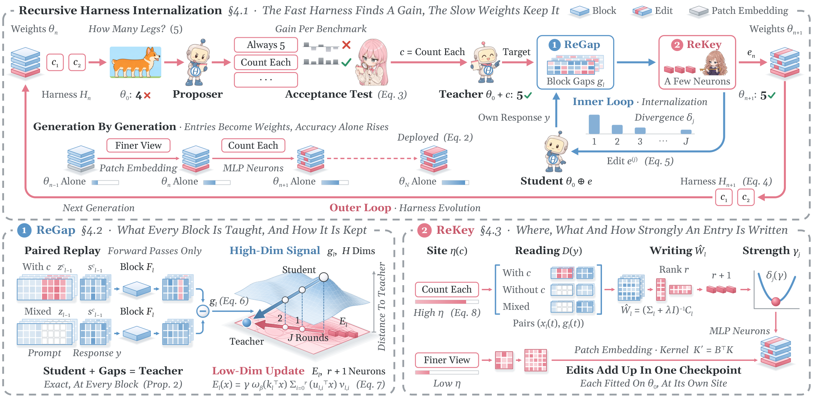

# BaseRSI: Recursive Self-Improvement of a Base Vision-Language Model via Training-Free Harness Internalization

<div align="center">

### Harness entries found by the model itself, written into its weights by training-free edits, no harness at deployment

<a href="https://arxiv.org/abs/2611.24578"></a>
<a href="https://huggingface.co/beita6969/BaseRSI-27B"></a>
<a href="https://huggingface.co/datasets/beita6969/BaseRSI-Dataset"></a>



</div>

## Overview

BaseRSI makes a base vision-language model stronger by letting it improve its **harness** and then write what the
harness adds into its own weights. It follows a paradigm of *Recursive Harness Internalization*: an outer loop
evolves the harness, the entries that rewrite a request with a procedure in the prompt or a finer view of the image,
and an inner loop moves every accepted entry into the weights through training-free edits, round after round on the
model's own responses. The base model fills every role with forward passes alone, and the edited checkpoint answers
the original request without the harness. The repository implements the three components of the paper:

- **Recursive Harness Internalization**: the base model improves its harness, then writes what the harness adds
  into its own weights through training-free edits, round after round on its own responses. In the outer loop the
  base model adds candidate entries to its harness and an acceptance test keeps those whose gain generalizes; in
  the inner loop the base model with an accepted entry in the request is the teacher and the same model on the
  original request is the student.
- **ReGap**: a mechanism that supervises every transformer block with the high-dimensional activation difference
  that the harness makes at that block alone, the teacher–student gap, and updates the block's weights along this
  signal in a low-dimensional subspace.
- **ReKey**: an algorithm that writes this signal by regression into a few key–value neurons of every block, and
  measures the site and strength of each edit on the model's own responses.

## Method

<div align="center">
  
</div>

### Harness entries

A harness is a set of entries. An entry has a scope and an action: the scope, answered by the base model as a
router, tells whether the entry applies to a request, and the action rewrites the request by adding a procedure to
the prompt or a finer view of the image. The entries are the parameters of the harness, as the weights are those of
the model.

### Recursive Harness Internalization

**Outer loop.** The base model proposes entries from its own failures, and an acceptance test keeps those whose
gain generalizes:

```text
A_n = { c :  p_gen(c) = max over b of p({d_b'(c)}, b' != b) <= alpha_c }
```

d_b(c) is the paired accuracy gain of adding c on the validation questions of benchmark b at an equal token budget,
p is the one-sided sign-flip p-value of the macro mean of its arguments, and alpha_c is the Holm threshold over the
candidates of generation n. A general entry is thus kept only when its gain is significant with any one benchmark
left out, and an entry for one benchmark only when its gain there is significant and no other benchmark is
significantly worse. Each accepted entry is tested on questions disjoint from those it was written from.

**Inner loop.** An accepted entry still acts through the request, so the inner loop moves it into the weights. The
base model with the entry in the request is the teacher, the same model on the original request is the student, and
the edit makes the student match its own teacher on the responses that it generates by itself. The edit changes
those responses, so it is fitted in rounds on the student's own responses:

```text
D(j) = D(j-1) + D(y),     y ~ student with edit e(j-1),     e(j) = ReKey(D(j))
```

D(y) are the labels of a response y, the gaps of ReGap, and ReKey(.) is the edit fitted on a set of labels. The
first two rounds replay the responses of the teacher and of the unedited student, and the later rounds those of the
edited student. Every round computes its labels with the unedited base model, so the labels of all rounds describe
one target and can be pooled, and the refit replaces the previous edit. Every edit is fitted on the base weights and
takes its own neurons or the patch kernel, so the edits add up in one checkpoint without refitting, and the
checkpoint with every edit is deployed alone.

### ReGap

ReGap states what the teacher teaches in every block, a high-dimensional signal, and in what form the student
keeps it, a low-dimensional update of the block's weights. The gap of block l is defined by running the block on
the teacher's states with and without the entry in the request:

```text
g_l = F_l(s^c_{l-1}; z^c_{l-1}) - F_l(s^c_{l-1}; z_{l-1})
```

where F_l is the output of block l at the response positions, z and s are the prompt states and the response
states, and c marks the states of the teacher. Both terms take the same response states, so g_l is what the entry
adds at block l alone, and it comes from forward passes, with no gradient propagated from the output. The update
that keeps it is a small set of key–value neurons in the MLP of the block:

```text
E_l(x) = gamma * w_beta(k_l . x) * sum_{i=0..r} (u_{l,i} . x) v_{l,i},     w_beta(z) = z * sigmoid(beta * z)
```

Each term reads the input x of the MLP along a readout u and writes a value v, the key k_l carries the scope of the
entry, gamma is the step, and r is far below the width of the model. Each term is one SwiGLU neuron, so an edit
rewrites r + 1 neurons per block, every other weight stays bit-identical, and the MLP keeps its architecture.

### ReKey

ReKey computes the update from forward passes alone: it first measures the site of an edit, then writes the gap by
regression into a few key–value neurons of every block, and finally measures its strength, all on the model's own
responses.

- **Site.** Before any fit, ReKey replays the student's own responses with the outputs of its linear-attention
  layers set to those of the teacher and measures the fraction of the divergence from the teacher that this removes:

  ```text
  eta(c) = 1 - KL(teacher || student with the teacher's linear-attention outputs) / KL(teacher || student)
  ```

  A high fraction sends the entry to the MLP neurons, which read the gap from the activations, and a low fraction
  sends it to the patch embedding, since such an entry changes what the model sees. For such a view entry and an
  up-sampling B of the image, the patch kernel K is resampled to K' = B^T K, so that the student embeds every patch
  of the original image as the teacher embeds it after up-sampling.

- **Reading.** ReKey reads the gap on a response by teacher-forced forward passes of the base model over its
  tokens, which label every block with the pairs (x_l(t), g_l(t)) of MLP input and gap at the sampled response
  positions.
- **Writing.** For every block, the fit is a linear readout of the MLP input by ridge regression on the pairs,
  with the mean gap b_l and the mean direction of the inputs removed (P_l). It is then reduced to the r directions
  that carry most of its predictions over all responses. Each direction fills one key–value neuron, and one more
  neuron carries the mean gap. Their key is fitted by ridge regression to tell the response positions where the gap
  is present from all other positions.

  ```text
  W_l = argmin over W of E || g - b_l - W^T P_l x ||^2 + lambda * ||W||^2
  ```

- **Strength.** The strength of an edit, its step gamma, is measured by a line search on held-out student
  responses, over a small set Gamma of steps:

  ```text
  gamma = argmin over Gamma of KL(teacher || student with the edit at step gamma)
  ```

## Repository Layout

```text
basersi/cli/                        entry points: basersi <command> (python -m basersi.cli)
basersi/pipeline.py                 all steps in order from one config
basersi/data/                       development questions from the official benchmark files
basersi/engine/                     model server, request dispatcher, reads, router, grader
basersi/loop/                       outer loop: proposer, generations, reports
basersi/judge/                      acceptance tests: sign-flip statistics, equal-token comparison
basersi/view_edit/                  view entry into the patch embedding (kernel resampling, image-token bounds)
basersi/procedure_edit/lab.py       paired teacher and student passes of the base model
basersi/procedure_edit/gap_capture.py   ReGap: block gaps and MLP inputs
basersi/procedure_edit/site.py      ReKey: site
basersi/procedure_edit/fit.py       ReKey: ridge fit and rank reduction
basersi/procedure_edit/key.py       ReKey: keys
basersi/procedure_edit/select.py    ReKey: line search of the step
basersi/procedure_edit/rounds.py    rounds of the inner loop
basersi/export/                     writes the edits into one checkpoint
basersi/config/                     configuration of the paper and the manifest of the development questions
figs/                               figures from the paper
```

## Requirements

- Python 3.12, PyTorch 2.14, Transformers 5.20, vLLM 0.33 (pinned in `pyproject.toml`)
- GPUs with 80 GB of memory: the servers of the outer loop, two cards for the reads of the acceptance tests, and
  one card for the Procedure Edit

All roles are the base model Qwen3.8-27B: it answers, proposes the entries and routes them. No external API is
called and no gradient is computed.

## Installation

```bash
git clone https://github.com/beita6969/BaseRSI.git BaseRSI
cd BaseRSI
pip install ".[gpu,sources]"
```

## Dataset

The paper evaluates ten visual reasoning benchmarks across perception, counting, charts, spatial reasoning and
visual logic: five in-distribution (ID) benchmarks supply the development questions and the ID tests, and five
held-out (OOD) benchmarks are used for testing only. Every set has 128 questions per benchmark.

**ID**:

| Benchmark | Fitting | Validation | Test | Source | License |
| --- | --- | --- | --- | --- | --- |
| BabyVision | 54 | 74 | 128 | `UnipatAI/BabyVision` | MIT |
| BLINK | 54 | 74 | 128 | `BLINK-Benchmark/BLINK` | Apache-2.0 |
| CharXiv | 54 | 74 | 128 | `princeton-nlp/CharXiv` | CC BY-SA 4.0 |
| VisuLogic | 54 | 74 | 128 | `VisuLogic/VisuLogic` | Apache-2.0 |
| VLMs Are Biased | 54 | 74 | 128 | `anvo25/vlms-are-biased` | MIT |

**Held-out (OOD)**:

| Benchmark | Test | Source | License |
| --- | --- | --- | --- |
| ChartQAPro | 128 | `ahmed-masry/ChartQAPro` | MIT |
| HallusionBench | 128 | `lmms-lab/HallusionBench` | BSD-3-Clause |
| PerceptionBench | 128 | `moonshotai/PerceptionBench` | CC BY-NC 4.0 |
| SpatialViz | 128 | `PLM-Team/Spatial-Visualization-Benchmark` | MIT |
| VisualPuzzles | 128 | `neulab/VisualPuzzles` | MIT |

The 640 development questions (fitting and validation) are the only data the pipeline reads. The repository ships
their manifest, `basersi/config/development_manifest.jsonl` (identifiers, roles and hashes), and `basersi data`
rebuilds the questions from the official files pinned in `basersi/config/sources.yaml` and checks every row against
it. Entries are proposed and edits are fitted on the fitting questions only; the acceptance tests score on the
validation questions.

The test sets (640 ID and 640 OOD questions with their images) are in the
[BaseRSI-Dataset](https://huggingface.co/datasets/beita6969/BaseRSI-Dataset). They share no question, image or
near-duplicate image with the development questions. The repository holds the training-free pipeline only;
evaluation on the test sets is not part of it.

## Running

```bash
basersi pipeline --config my_config.yaml --only data                                # build the development questions
basersi serve server --model /path/to/Qwen3.8-27B --queue-dir runs/queue            # model server of the outer loop
basersi serve dispatcher --queue-dir runs/queue --rows data/development.jsonl       # sends the loop's requests to the servers
basersi pipeline --config my_config.yaml                                            # all steps
```

A minimal config:

```yaml
work_dir: runs/basersi
data_dir: data
model: /path/to/Qwen3.8-27B
data:
  sources: /path/to/official_benchmark_files
loop:
  queue_dir: runs/queue
```

`basersi pipeline` runs the steps in order: development questions, outer loop, acceptance of its entries, View
Edit, its acceptance, Procedure Edit, export, and the acceptance of the Procedure Edit. It stops at an acceptance
gate when an entry or an edit is not accepted, and the same command resumes a stopped run. `--list` prints the
steps, and `--only`, `--from` and `--to` run a part. Every command lists its inputs and options with `--help`.

Each step writes into `work_dir`: the state of the run (`pipeline_state.json`), the run folder of the loop, the
verdicts of the acceptance tests, the View Edit checkpoint, the files of the Procedure Edit, and the exported
checkpoint.

Settings of the paper (`basersi/config/`):

| Category | Setting |
| --- | --- |
| Base model | Qwen3.8-27B (64 blocks) with its original weights as executor, proposer and router |
| Outer loop | 8 generations (`loop.generations`) |
| Acceptance test | alpha = 0.10 with the Holm correction over the candidates of a generation; one-sided sign-flip over picture groups, 20,000 flips |
| View Edit | patch size 16 to 8; 2,048 to 4,096 image tokens per image |
| Procedure Edit | all 64 blocks; rank r = 64, 65 neurons per block; J = 3 rounds |
| Ridge weight | {0.03, 0.3, 3} x mean diagonal of the input covariance, chosen on a held-out fold |
| Key | slope beta = 8, threshold 0.25 |
| Step | line search over {0.5, 0.75, 1, 1.25, 1.5, 1.8, 2, 2.6} on held-out student responses in every round; it selects 1.8 for the published model (`--step` fixes the final step without the search) |
| Positions per response | 5 template-tail positions and up to 512 (round 1) or 256 (rounds 2 and 3) reasoning positions |

## Model and Data

| Item | Location |
| --- | --- |
| Model weights (the edited checkpoint of the paper, Qwen3.8-27B with both edits) | [beita6969/BaseRSI-27B](https://huggingface.co/beita6969/BaseRSI-27B) |
| Evaluation sets (640 ID and 640 held-out questions with their images) | [beita6969/BaseRSI-Dataset](https://huggingface.co/datasets/beita6969/BaseRSI-Dataset) |
| Development questions (640, manifest of identifiers and hashes) | `basersi/config/development_manifest.jsonl` |
| Base model | [Qwen/Qwen3.8-27B](https://huggingface.co/Qwen/Qwen3.8-27B) |

The checkpoint loads as the base model does and answers the original request.

## Citation

If you use BaseRSI, please cite the paper:

```bibtex
@article{zhang2026basersi,
  title = {{BaseRSI}: Recursive Self-Improvement of a Base Vision-Language Model via Training-Free Harness Internalization},
  author = {Zhang, Mingda and Dong, Yuanhao and Huang, Qiang and Qian, Rui and Li, Yanjin and Liu, Zhenyu and Huang, Xiao and Yang, Zihao and Wang, Jian and He, Pinjia and Tang, Xiaoying},
  journal = {arXiv preprint arXiv:2611.24578},
  year = {2026},
  doi = {10.48550/arXiv.2611.24578},
  url = {https://arxiv.org/abs/2611.24578}
}
```

## License

This repository is released for research use. Please also follow the licenses and terms of the upstream model,
datasets and benchmarks used with BaseRSI; the sources and licenses of the benchmark files and prompt templates are
listed in `basersi/config/sources.yaml`.
